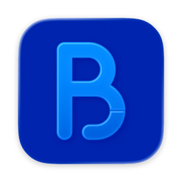
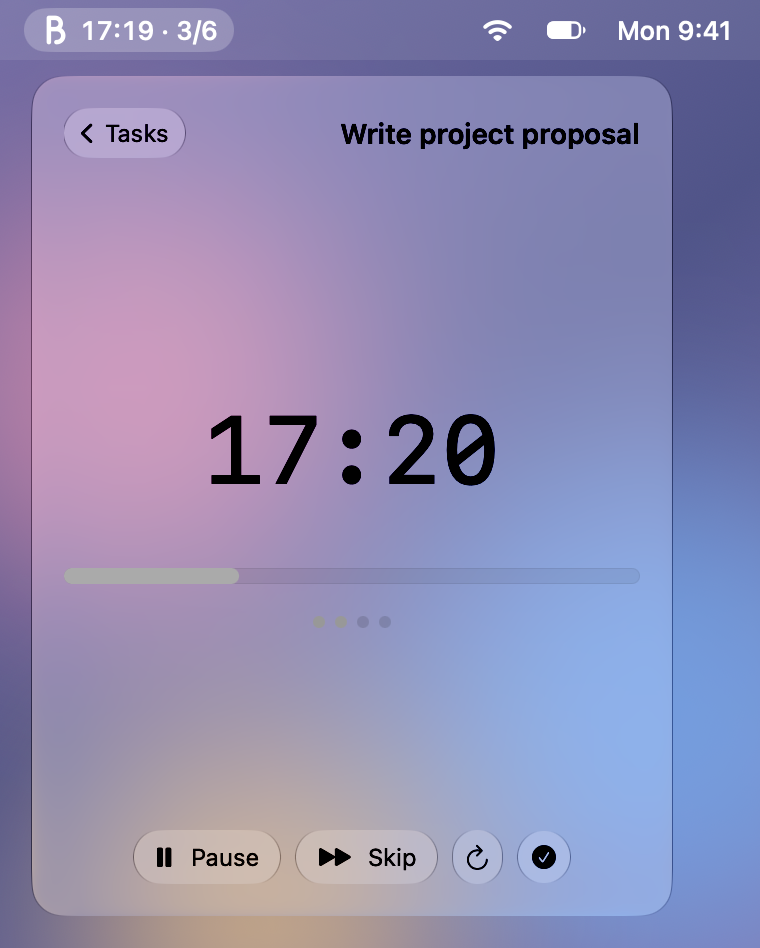
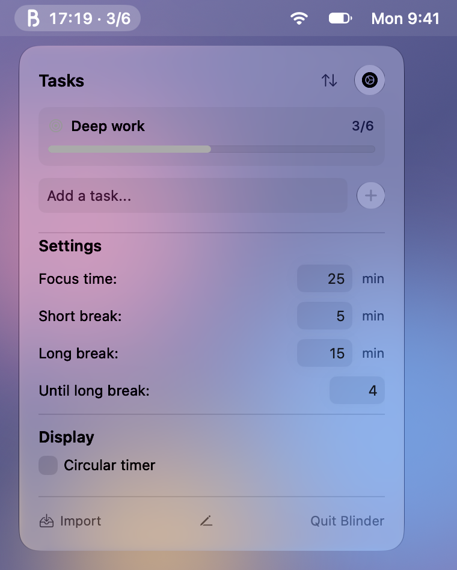
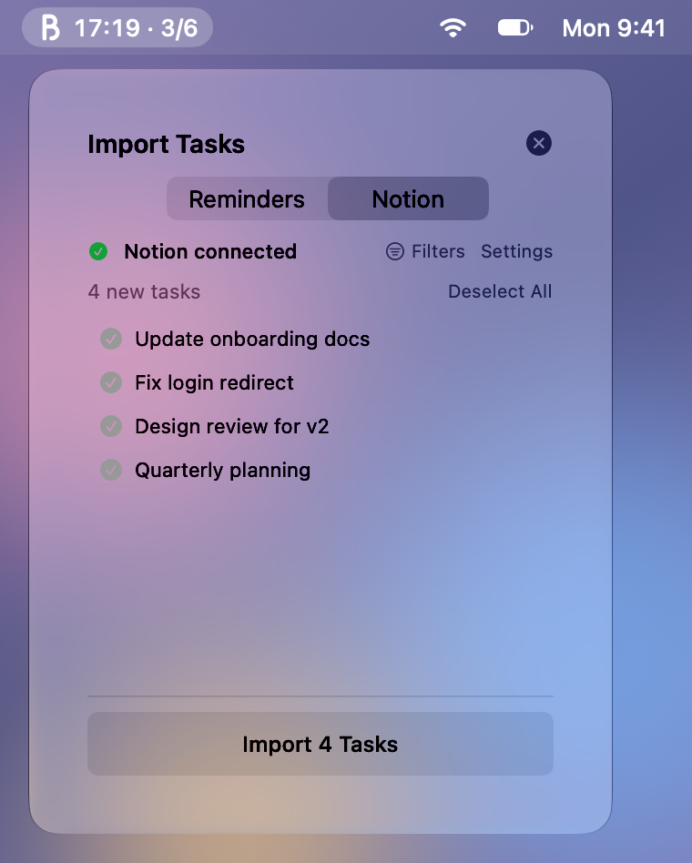
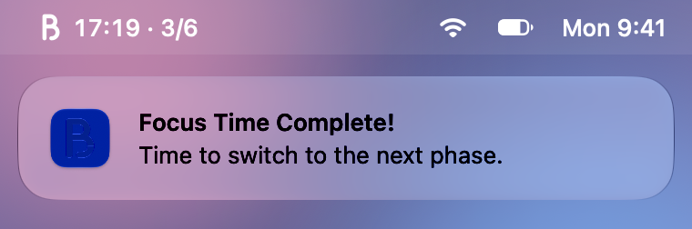

  

<h1 align="center">Blinder</h1>

  <b>A calm Pomodoro timer that lives in your Mac's menu bar.</b> 
  Pick a task, hit start, and let Blinder keep time — no windows, no account, no distractions.

  <a href="https://github.com/jakseg/Blinder-Releases/releases/latest"><b>⬇&nbsp;Download for macOS</b></a>
  &nbsp;·&nbsp; free &nbsp;·&nbsp; macOS 26 Tahoe

https://github.com/user-attachments/assets/c8fef2e8-a0cd-434e-8b76-db46e46ce3de

## Why Blinder

- **Always in sight** — the countdown and today's progress sit in your menu bar (`17:19 · 3/6`).
- **Pomodoro on autopilot** — focus, short break, long break. The next phase starts by itself if you want it to.
- **A daily goal** — decide how many pomodoros today is worth and watch the counter fill up.
- **Built around tasks** — every task tracks its pomodoros and time worked; finished ones move to *Completed today*.
- **Brings your tasks along** — import from Apple Reminders or Notion. Notion tasks sync automatically and are marked done in Notion when you finish them.
- **Gentle alerts** — a banner and a macOS sound of your choice when a phase ends, configurable per phase.
- **Private by design** — everything stays on your Mac. No account, no analytics; the only connection is Notion, if you set it up.

## Screenshots

| Timer | Settings |
|:---:|:---:|
|  |  |
| **Notion import** | **Phase complete** |
|  |  |

## Install

1. [Download the latest `.dmg`](https://github.com/jakseg/Blinder-Releases/releases/latest) and drag **Blinder** into *Applications*.
2. Open Blinder. Because it isn't notarized by Apple yet, macOS blocks the first launch — go to **System Settings → Privacy & Security** and click **Open Anyway** (only once).
3. Click the **B** in your menu bar — a short tour shows you around, then allow notifications when asked.

Press `Space` to start or pause the timer.

<b>Connect Notion</b>

1. Create an integration at [notion.so/my-integrations](https://www.notion.so/my-integrations) and copy its secret.
2. In your task database, open **••• → Connections** and add the integration.
3. Copy the database ID from its URL: `notion.so/<workspace>/<DATABASE_ID>?v=…`
4. In Blinder, open **Import → Notion**, paste both and click **Connect & Load Tasks**.

Blinder detects your status property and its *Done* value automatically. The secret is stored in your macOS Keychain and only ever sent to `api.notion.com`.

## Requirements

macOS 26 (Tahoe) or later.

---

Blinder is free to use. All rights reserved — the source code is not included in this distribution.
